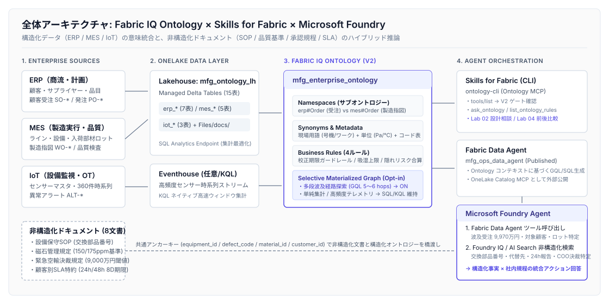

# Microsoft Fabric Ontology × Skills for Fabric 実践ハンズオンラボ

**[GitHub Copilot CLI](https://docs.github.com/en/copilot/concepts/agents/copilot-cli)** に **[Skills for Fabric (`microsoft/skills-for-fabric`)](https://github.com/microsoft/skills-for-fabric)** を組み込み、**ERP・MES・IoT の構造化データ**と **SOP・品質基準・社内承認規程・顧客SLA などの非構造化ドキュメント**を横断するエンタープライズ・オントロジーを設計・構築・活用する実践ハンズオンです。

「そもそもどんなオントロジーを作るべきか」を AI と相談して設計するステップから始まり、**サブオントロジー（Namespace）・同義語（Synonym）・メタデータ（Metadata）・ビジネスルール（Business Rules）** によってエージェントのコンテキスト理解と回答精度がどう劇的に向上するか、さらに **グラフエンジン（Materialized Graph / GQL）を設定すべきシナリオ vs 設定しない方がいいシナリオ**、そして **Fabric Data Agent（Ontology）と Microsoft Foundry（非構造化ドキュメント検索）の統合オーケストレーション** までを一気通貫で体験します。



---

## 🎯 このハンズオンで学べること

1. **オントロジー設計相談（Plan ファースト）**: 既存テーブル（ERP / MES / IoT）と現場ヒアリングメモをもとに、どこまでを Entity / Property / Relationship にし、どこを非構造化ナレッジに残すべきかを Copilot CLI・Ontology Agent と壁打ちして設計する（Lab 02）。
2. **セマンティック設定による回答精度の Before / After 検証**:
   - **Namespaces（サブオントロジー）**: 営業の「オーダー（`erp#Order` = 顧客受注）」と製造現場の「オーダー（`mes#Order` = 製造指図）」という同名概念の衝突を解消する。
   - **Synonyms（同義語）**: 「号機」「ワーク」「チョコ停アラーム」などの現場用語を Entity Type に紐づける。
   - **Metadata（説明＋Key-Value属性）**: 数値コード（`3=AtRisk`, `30=QualityHold`）や物理単位（`Pa`, `℃`, `ppm`）のブラックボックスを解消する。
   - **Business Rules（自然言語ルール）**: 校正期限超過ガードレール・磁石吸湿上限・ERP未更新の「隠れ納期リスク」合算ルールを定義し、エージェントが自律的に違反を検出できるようにする（Lab 03・Lab 04）。
3. **グラフエンジン（Materialized Graph）の要否判断**:
   - **設定した方がいいシナリオ**: 設備異常・部材ロットから 5〜6 ホップ先の Tier 1 顧客受注までたどる波及影響分析（Blast Radius）や共通原因探索（GQL）。
   - **設定しない方がいいシナリオ**: 製品別の売上全体集計（Lakehouse SQL / DAX）や高頻度 IoT センサーの時系列監視（Eventhouse KQL）など、ソースネイティブ実行の方が高速・高鮮度・低コストなケース（Lab 05）。
4. **Fabric Data Agent × Microsoft Foundry ハイブリッド構成**:
   - 構造化データとビジネスルールは **Fabric Data Agent から Ontology を呼び出して** 正確に特定し、交換部品番号・代替サプライヤー切替条件・8D報告期限・緊急空輸の決裁権限（9,000万円閾値）は **Microsoft Foundry 上の非構造化ドキュメント検索** から根拠付きで統合回答させる（Lab 06・Lab 07）。

---

## 🏭 業務シナリオ：Contoso Precision Motors（精密電動アクチュエータ製造）

産業用ロボット・EV・半導体装置向けの精密アクチュエータを製造する **Contoso Precision Motors**（名古屋・浜松・北九州の3工場）が舞台です。リポジトリの `data/` 配下には、決定論的に生成・検証済みの4領域ダミーデータが同梱されています。

| データ領域 | 格納先 | 内容と件数 | シナリオ上の役割 |
| :--- | :--- | :--- | :--- |
| **ERP（商流・調達）** | `data/erp/*.csv` | 7テーブル（顧客10社、サプライヤー8社、品目12件、製品6件、BOM 18件、顧客受注24件、購買発注16件） | Tier 1 戦略顧客の受注金額・納期・SLA違約金、主/代替サプライヤー情報 |
| **MES（製造実行・品質）** | `data/mes/*.csv` | 5テーブル（ライン6本、設備15台、部材ロット18件、製造指図30件、品質検査24件） | 浜松第2ライン真空ろう付け炉 `EQ-VBF-204` の保全隔離、磁石ロット `LOT-MAG-088`（182 ppm）と品質保留 `WO-*` |
| **IoT（設備監視・OT）** | `data/iot/*.csv`, `.jsonl` | 3テーブル（センサー15台、時系列テレメトリ360件、設備アラート10件） | `ALT-VAC-LEAK`（9.5 Pa / 28分）・`ALT-TMP-HIGH`（859.4 ℃）やスピンドル振動スパイク |
| **非構造化ドキュメント** | `data/unstructured_docs/*.md` | 8文書（設備SOP 2本、品質基準書、緊急空輸決裁規程、磁石管理規定、過去8D報告、顧客SLA特約、現場用語メモ） | 指定交換部品 `PART-SEAL-KF40-VT`、代替先 `SUP-007`、24時間8D報告義務、**受注影響総額 9,000万円以上の COO 決裁ルール** |

---

## ⚡ クイックスタート：GitHub Codespaces で始める（推奨）

### 起動手順

1. このリポジトリの GitHub ページ右上にある緑色の **`<> Code`** ボタンをクリックし、**`Codespaces`** タブから **`Create codespace on main`** をクリックします。
2. ブラウザ（または VS Code デスクトップ）で Codespace が起動すると、`.devcontainer/devcontainer.json` により Copilot CLI・`skills-for-fabric` (`v0.3.22`)・`sqlcmd` の自動セットアップが実行されます。ターミナルで環境チェックを実行して完了を確認します。
   ```bash
   bash .devcontainer/scripts/verify.sh
   ```
   すべての項目が `[OK]` と表示され、`Environment verification completed successfully.` が出れば準備完了です。
3. 続けて **[Lab 00 の 0-6（GitHub Copilot CLI へのサインイン）](./labs/00-prerequisites.md#0-6-github-copilot-cli-を起動してサインインする)** へ進み、**0-7 で自分の `student` 番号を一度登録**したら **[Lab 01](./labs/01-login-and-data-setup.md)** を開始してください。

> 💡 ローカル PC（macOS / Linux / Windows WSL2）で進める場合は、[Lab 00 — 事前準備](./labs/00-prerequisites.md) の 0-1 から順にツールを導入してください。

---

## 📋 事前要件（Prerequisites）

### 参加者ごとに必要なもの

| 項目 | 要件 |
| :--- | :--- |
| **GitHub アカウント** | **GitHub Copilot** ライセンス（Copilot Pro / Business / Enterprise 等）が有効であること |
| **Microsoft Entra ID アカウント** | 配布された `student<番号>` アカウント（または自身の Fabric テナントアカウント）。Ontology MCP・Data Agent MCP は**委任ユーザー認証（`az login`）必須**です |
| **Microsoft Fabric ワークスペース** | **Fabric 容量（F2 以上推奨、Trial 可）** に紐づいたワークスペースの **Contributor（共同作成者）以上**の権限 |
| **Microsoft Foundry 接続先（Lab 07）** | 講師から共有された既存の **Microsoft Foundry Project（Azure OpenAI / Azure AI Search または Vector Store）** へのアクセス権 |

### 講師・テナント管理者向けの事前確認（Preflight）

ハンズオン開始前に、Fabric 管理ポータル（Tenant settings）および Microsoft Foundry 側で以下が有効になっていることを確認してください。

1. **Ontology item (preview)**: テナント設定で **Ontology item (preview)** が有効であること（無効な場合、ワークスペースで Ontology アイテムの作成や MCP 呼び出しができません）。
2. **Graph (preview)**: テナント設定で **Graph (preview)** が有効であること（Lab 05 の Materialized Graph / GQL 検証で使用）。
3. **Fabric Data Agent (preview) & Copilot / Azure OpenAI**: **Copilot and Azure OpenAI Service**（クロスジオ処理・データ保存の許可を含む）および **Data Agent (preview)** が有効であること。
4. **Microsoft Foundry 既存リソースの共有（Lab 07）**: 参加者が個別に課金リソースを乱立させないよう、講師側でプロビジョニング済みの Microsoft Foundry プロジェクト（GPT-4o / GPT-4.1 系デプロイメントおよび Azure AI Search または Foundry IQ ナレッジベース権限）を共有することを推奨します。

---

## 📚 ラボ構成と所要時間（目安：約 150〜180 分）

すべてのラボは **「🗣️ プロンプト → 🤖 Copilot の動き → ✅ 期待する結果」** の形式で統一されています。Lab 00 で一度 `student` 番号を登録すれば、以降のラボではプレースホルダーの書き換えなしでプロンプトをそのまま貼り付けて進められます。

| ラボ | タイトル | 主なテーマ・検証ポイント | 目安時間 |
| :--- | :--- | :--- | :---: |
| **[ポータル接続ガイド](./labs/fabric-portal-login.md)** | Fabric ポータルへの初回サインイン | ブラウザのプロファイル分離とワークスペース確認 | 5 分 |
| **[Lab 00](./labs/00-prerequisites.md)** | 事前準備と Skills for Fabric の導入 | Copilot CLI・`skills-for-fabric` (`v0.3.22`) 導入、`student` 番号登録 | 15 分 |
| **[Lab 01](./labs/01-login-and-data-setup.md)** | サインインと ERP・MES・IoT・非構造化データの準備 | `mfg_ontology_lh` 作成、15個の管理 Delta テーブル投入、固定レコード検証 | 20 分 |
| **[Lab 02](./labs/02-ontology-design-consultation.md)** | **どんなオントロジーを作るべきか AI に相談・設計する** | Competency Questions 整理、Entity/Property 切り分け、`erp#Order` vs `mes#Order` 設計、構造化/非構造化の境界策定 | 20 分 |
| **[Lab 03](./labs/03-create-base-ontology.md)** | ベースオントロジーの構築とエンリッチ前の弱点確認 | V2 Ontology 作成・データバインド・リレーション定義、**設定前（Before）の誤答・曖昧回答の観察** | 25 分 |
| **[Lab 04](./labs/04-namespaces-synonyms-metadata-rules.md)** | **Namespace・Synonym・Metadata・Rules の設定と精度比較** | サブオントロジー定義、現場用語の同義語、単位・コード表メタデータ、4つのビジネスルール設定と **Before/After 比較検証** | 30 分 |
| **[Lab 05](./labs/05-graph-engine-scenarios.md)** | **グラフエンジンを設定すべきシナリオ vs 使わない方がいいシナリオ** | Selective Materialization、5ホップ波及分析（GQL） vs 売上全体集計（SQL）・高頻度時系列監視（KQL）の徹底比較 | 25 分 |
| **[Lab 06](./labs/06-data-agent-ontology-context.md)** | Fabric Data Agent から Ontology を呼び出して検証・公開する | Data Agent への Ontology 接続、`Download ontology context` 確認、推論トレース検証、外部連携向け Publish | 20 分 |
| **[Lab 07](./labs/07-foundry-hybrid-unstructured.md)** | **Microsoft Foundry で Ontology Data Agent と非構造化データを統合する** | Foundry IQ / AI Search への規程・SOP・SLA登録、Published Data Agent 連携、9,970万円リスク×COO決裁の統合回答 | 25 分 |
| **[用語集](./labs/glossary.md)** | Fabric IQ Ontology & Foundry 用語リファレンス | Namespace, Contextualization, GQL, Ontology MCP などの重要概念整理 | — |

---

## ⚠️ 現在の既知制約と API / ポータル UI の使い分け（2026年時点・必読）

本ハンズオンでは、プレビュー機能や REST API スキーマの制限を曖昧にごまかさず、**「どこまでが CLI / MCP / REST API で自動化でき、どこが Fabric ポータル UI 操作を必要とするか」** を明確に区別して扱います。

| 領域 | 現在の仕様・制約（事実） | 本ハンズオンでの進め方 |
| :--- | :--- | :--- |
| **`ontology-cli` の V1 Authoring と V2 Consumption の非対称性** | `skills-for-fabric` (`v0.3.22`) の `ontology-cli` において、自然言語照会（`ask_ontology`, `list_ontology_entities`, `list_ontology_rules`）は **V2（New Experience / TMDL）専用**です。一方、`ontology-cli` 同梱の JSON Authoring テンプレートは **Legacy V1 専用**（2027年1月廃止予定）であり、また生の TMDL だけを REST `updateDefinition` で投入するとポータルが付与する `ONT_` パーティション注釈が欠けて Graph 非適格と判定される既知事象（`skills-for-fabric#107`）があります。 | V2 Ontology アイテムの作成・TMDL 構造確認・MCP 自然言語検証は CLI で行い、V2 のバインド確定・Namespace/Rules 編集・Graph Materialize は **ポータルの Ontology Agent（Plan → Act）および Configuration Canvas** を併用して確実に構成します。 |
| **Synonym（同義語）の設定対象** | Fabric Ontology (Preview) では、**Synonym は Entity Type に対してのみ設定可能**であり、個々の Property や Relationship Type には Synonym 欄がありません。 | 現場での別名（「号機」「ワーク」等）は Entity Type の **Synonyms** に設定し、カラム単位のコード定義や単位は Property の **Description / Additional Metadata（Key-Value）** に設定します。 |
| **Business Rules の役割** | Ontology V2 の Business Rules は **AI エージェント（Ontology Agent / Data Agent / Foundry Agent）が推論時に参照する自然言語ガードレール**であり、単体で自動アラート発報（Activator 実行）を行うトリガーエンジンではありません。 | `list_ontology_rules` および `ask_ontology` を通じて、エージェントが「校正期限超過の投入待ち指図」や「ERP未更新の隠れリスク受注」をルールに基づき自律指摘できることを検証します。 |
| **Fabric Data Agent への Ontology / AI Search 接続** | Data Agent の公開 REST 定義スキーマ（`dataSource/1.0.0/schema.json`）では `ontology` や `azure_ai_search` のソース追加はポータル UI 主導のプレビュー構成となっており、公開後の呼び出しは Data Agent MCP エンドポイントで行います。 | Lab 06 でポータルから Ontology をソース接続して `Download ontology context` と精度向上を確認したうえで Publish し、Lab 07 で Microsoft Foundry から統合呼び出しを行います。 |
| **認証方式（Service Principal 非対応）** | Ontology Agent MCP エンドポイントおよび Data Agent MCP エンドポイントは現在 **委任ユーザー トークン（`az login`）のみ対応**しており、Service Principal（クライアントシークレット認証）はサポートされていません。 | 全ラボを通して `az login --use-device-code` によるユーザー認証を使用します。 |

---

## 📁 リポジトリ構成

```text
fabric-ontology-handson-lab/
├── README.md                                  # 本ガイド
├── .github/
│   └── copilot-instructions.md                # student番号自動解決・MCP/API遵守ルール
├── .devcontainer/
│   ├── devcontainer.json                      # GitHub Codespaces / Dev Container 自動セットアップ定義
│   ├── Dockerfile                             # Python 3.12 ベース固定イメージ
│   └── scripts/
│       ├── versions.env                       # Copilot CLI / skills-for-fabric v0.3.22 固定定義
│       ├── setup.sh                           # プラグイン・sqlcmd セットアップスクリプト
│       └── verify.sh                          # 環境＆ローカルアセット一括検証スクリプト
├── data/
│   ├── erp/                                   # ERP ダミーデータ (7 CSV)
│   ├── mes/                                   # MES ダミーデータ (5 CSV)
│   ├── iot/                                   # IoT ダミーデータ (3 CSV + 1 JSONL)
│   ├── unstructured_docs/                     # 非構造化ドキュメント (8 Markdown + カタログ CSV)
│   └── expected_oracle.json                   # 決定論的検証用の正解値（件数・波及金額・集計値）
├── ontology/
│   ├── design-blueprint.json                  # Lab 02〜04 のターゲット Ontology 設計ブループリント
│   ├── evaluation_questions.json              # Before/After 精度比較＆Graph ON/OFF 検証テスト集
│   └── v2_tmdl/                               # Fabric Ontology V2 (New Experience) TMDL リファレンス定義
├── scripts/
│   ├── generate_handson_data.py               # ダミーデータ＆正解オラクル生成スクリプト（標準ライブラリのみ）
│   ├── ontology_mcp_client.py                 # Ontology V2 MCP 検証クライアント (`x-ms-fabric-skill` 準拠)
│   ├── foundry_hybrid_agent.py                # Microsoft Foundry × Fabric Ontology ハイブリッド検証スクリプト
│   └── verify_local_assets.py                 # データ整合性・オントロジースキーマ自動検証スクリプト
├── labs/
│   ├── fabric-portal-login.md                 # ポータル初回サインイン手順
│   ├── 00-prerequisites.md                    # Lab 00: 事前準備と student 番号登録
│   ├── 01-login-and-data-setup.md             # Lab 01: Lakehouse / OneLake データ準備
│   ├── 02-ontology-design-consultation.md     # Lab 02: どんなオントロジーを作るべきか相談・設計
│   ├── 03-create-base-ontology.md             # Lab 03: ベースオントロジー構築と Before 検証
│   ├── 04-namespaces-synonyms-metadata-rules.md # Lab 04: Namespace / Synonym / Metadata / Rules 設定
│   ├── 05-graph-engine-scenarios.md           # Lab 05: グラフエンジン ON vs OFF シナリオ検証
│   ├── 06-data-agent-ontology-context.md      # Lab 06: Data Agent からの Ontology 呼び出しと公開
│   ├── 07-foundry-hybrid-unstructured.md      # Lab 07: Microsoft Foundry 非構造化データ統合
│   ├── glossary.md                            # 用語集
│   └── images/                                # アーキテクチャ図・Namespace図・Graph判断基準図 (SVG)
└── tests/
    └── test_handson_repo.py                   # リポジトリ全体の自動テストスイート (unittest)
```
