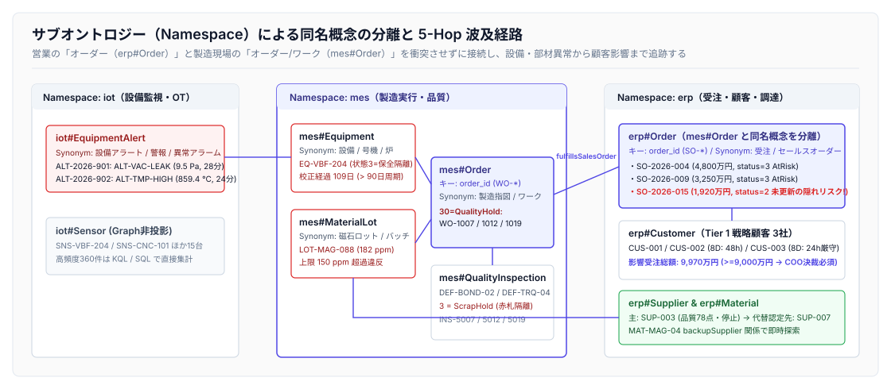

# Lab 02 — どんなオントロジーを作るべきか AI に相談・設計する（Ontology Design Consultation）

> **所要時間**: 約 20 分  
> **ゴール**: いきなり Fabric 上でテーブルを機械的にオントロジー化するのではなく、業務課題・既存テーブルスキーマ・現場ヒアリングメモをもとに **「そもそもどんなオントロジー（Entity / Namespace / Synonym / Metadata / Rules / 構造化・非構造化の境界）を作るべきか」** を AI と壁打ちして設計ブループリントを固める。

---

## 2-1. なぜ「1テーブル＝1エンティティの丸写し」は失敗するのか？

オントロジー導入プロジェクトで最も多い失敗は、**「DWH や Lakehouse にある全テーブルをそのまま 1 対 1 で Entity Type にしてしまうこと」** です。今回の Contoso Precision Motors のデータにも、現場でよくある 4 つの罠が含まれています。

1. **同名概念の衝突（Naming Collision）**:
   営業部門の `erp_sales_orders` も、工場の `mes_work_orders` も主キーが `order_id` であり、どちらも社内では「オーダー」と呼ばれています。フラットな空間に並べると AI が誤選択を起こします。
2. **数値コードと単位のブラックボックス**:
   `order_status_code = 3` や `peak_value = 9.5` が何を意味するか、物理スキーマからは分かりません。
3. **トランザクション／高頻度ログの過剰グラフ化**:
   `iot_telemetry`（時系列計測行）や全明細テーブルまで無差別に Graph ノードにすると、CU（容量）消費とリフレッシュ時間が増大します。
4. **構造化ルールと非構造化 SOP の混同**:
   「校正周期超過の設備は Tier 1 案件に割当禁止」という判定ルールは Ontology の **Business Rules** に向いていますが、「フランジの交換部品番号 `PART-SEAL-KF40-VT` やヘリウムリーク試験手順」のような長文手順書は **Microsoft Foundry の非構造化ナレッジベース** に置き、共通キー（`equipment_id`）で橋渡しするのが正解です。

---

## 2-2. Step 1: スキーマと現場ヒアリングメモを読ませて初期設計案を出させる

まずは GitHub Copilot CLI に、ローカルの `data/` 配下の実スキーマと、各部門へのインタビュー記録（`data/unstructured_docs/GLOSSARY_enterprise_domain_terms.md`）を読み込ませ、**まだ Fabric 上には何も作らずに（Plan ファースト）** オントロジー設計案を提案させてみましょう。

> 🗣️ **プロンプト**
> ```text
> まだ Fabric 上には何も作成しないでください。オントロジーの設計相談をしたいです。
> ローカルの data/erp/*.csv、data/mes/*.csv、data/iot/*.csv のヘッダー・サンプル行と、data/unstructured_docs/GLOSSARY_enterprise_domain_terms.md、および他の非構造化ドキュメントの見出しを分析して、次の5点を日本語で提案してください。
>
> 1. この製造企業が解くべき代表的な Competency Questions（業務上の重要な問い）5つ
> 2. どのテーブルを Entity Type にすべきか、逆に独立 Entity や Graph 投影から外すべきテーブル（時系列や中間マスタなど）はどれか
> 3. 営業の「オーダー」と製造現場の「オーダー」のような同名概念の衝突を、サブオントロジー（Namespace）でどう分離すべきか
> 4. エージェントの回答精度を上げるために設定すべき Synonym・Metadata（単位やコード表）・Business Rules の候補
> 5. Fabric Ontology（構造化）に持たせる情報と、Microsoft Foundry（非構造化ドキュメント検索）に残して連携させる情報の役割分担と共通アンカーキー
> ```

🤖 **Copilot の動き**

- `data/erp`（7 CSV）、`data/mes`（5 CSV）、`data/iot`（3 CSV）、および `GLOSSARY_enterprise_domain_terms.md` などの Markdown 文書を横断的に読み込みます。
- テーブル物理構造と業務語彙のギャップを分析し、5つの観点からオントロジー設計案を構造化して提示します。

✅ **期待する結果**

Copilot から次のような設計提案が返ってきます（自分の言葉でさらに深掘り質問しても構いません）：

- **Namespace 分割案**: `erp`（商流・調達）、`mes`（製造実行・品質）、`iot`（設備監視・OT）の3つのサブオントロジーに分割し、**`erp#Order`（顧客受注 `SO-*`）** と **`mes#Order`（製造指図 `WO-*`）** を自然な業務名のまま共存させる提案。
- **Entity vs 時系列の切り分け**: `iot_telemetry`（360件〜本番数千万件の時系列データ）は1行ずつの Graph Entity にするのではなく、`mes#Equipment`（または `iot#Sensor`）の時系列バインド／Eventhouse KQL・SQL 集計対象とすべきという指摘。
- **構造化 × 非構造化の境界**: `equipment_id`（例: `EQ-VBF-204`）、`defect_code`（例: `DEF-BOND-02`）、`material_id`（例: `MAT-MAG-04`）、`customer_id`（例: `CUS-003`）を共通アンカーキーとして、数値・関係探索は Ontology、手順・契約条項・決裁金額マトリクスは Foundry 非構造化検索に分担する設計。

---

## 2-3. Step 2: 設計のトレードオフを AI に突っ込んで相談する（壁打ち体験）

実務のオントロジー設計でよく議論になる **3 つの悩ましいポイント** について、Copilot にさらに踏み込んで相談してみましょう。

> 🗣️ **プロンプト**
> ```text
> 今の設計案について、さらに3点相談させてください。
> 質問1: erp#Order と mes#Order に Namespace で分ける方法と、Namespace を使わずに SalesOrder / WorkOrder と別名にする方法では、それぞれどんなメリット・デメリットがありますか？どんな組織規模・ガバナンス要件なら Namespace を使うべきですか？
> 質問2: erp_bom（部品表 18行）や erp_purchase_orders（購買発注 16行）は今回の波及影響分析（設備異常・部材ロット異常 → 顧客受注）で Graph に Materialize すべきですか？それとも mes#MaterialLot -> erp#Supplier / erp#Material の関係があれば十分ですか？
> 質問3: 非構造化ドキュメント POL-SCM-002 に書かれている「影響受注総額 9,000万円以上なら COO 決裁」という基準は、Ontology の Business Rules にも書くべきですか？規程改定時のメンテナンス性の観点で推奨を教えてください。
> ```

🤖 **Copilot の動き**

- Fabric IQ Ontology の仕様（Namespace の URI/部門オーナーシップ、Graph の選択的投影コスト、Business Rules と外部規程文書の二重管理リスク）を踏まえてトレードオフを解説します。

✅ **期待する結果**

以下の設計判断の指針が得られます：

| 論点 | 相談から得られる設計のベストプラクティス |
| :--- | :--- |
| **1. Namespace vs 別名付与** | 小規模・単一部門なら `SalesOrder` / `WorkOrder` の別名でも十分だが、**複数部門のサブオントロジーを統合する場合や外部標準語彙（ISA-95 / RDF）と整合させる場合**は、各部門が慣れ親しんだ `Order` という概念名を壊さず `erp#Order` / `mes#Order` としてオーナー部門ごとに統制できる **Namespace** が有効。 |
| **2. Graph 投影の絞り込み** | 波及トレースの本線は `iot#EquipmentAlert → mes#Equipment ← mes#Order → mes#MaterialLot → erp#Supplier` および `mes#Order → erp#Order → erp#Customer`。`erp_purchase_orders` のような伝票明細まで常に Graph に載せる必要はなく、**必要なエンティティだけを選択的に Materialize** する方が高速で経済的。 |
| **3. Rules と規程文書の分担** | **Ontology の Business Rules** には普遍的な構造ルール（「ERP が `InProduction` でも MES が `QualityHold` なら実質リスク受注として合算する」等）を定義し、毎年変わりうる具体的な金額テーブルや交換部品型番は **Foundry の非構造化規程書（`POL-SCM-002`, `SOP-EQ-VBF-204`）** を単一の正（Single Source of Truth）として参照させるのが保守性に優れる。 |

---

## 2-4. Step 3: リファレンス設計ブループリント（`ontology/design-blueprint.json`）との照合

このハンズオンでは、以降の Lab 03〜Lab 07 で全員が同じ検証結果を得られるよう、確定版の設計書を `ontology/design-blueprint.json` に用意しています。今相談した内容と照らし合わせて確認しましょう。



> 🗣️ **プロンプト**
> ```text
> リポジトリ内の ontology/design-blueprint.json を読み込み、定義されている3つの Namespace、13個の Entity Type（うち Graph 投影対象の11個と非投影の2個）、16個のリレーションシップ、4つの Business Rules の一覧をコンパクトな表にまとめて表示してください。
> ```

🤖 **Copilot の動き**

- `ontology/design-blueprint.json` を解析し、Lab 03（ベース構築）と Lab 04（セマンティック拡張）で実装するターゲット設計の一覧表を表示します。

✅ **期待する結果**

- **Namespaces (3)**: `erp`, `mes`, `iot`
- **Entity Types (13)**:
  - Graph 投影 ON (11): `erp#Customer`, `erp#Supplier`, `erp#Material`, `erp#Product`, `erp#Order`, `mes#ProductionLine`, `mes#Equipment`, `mes#MaterialLot`, `mes#Order`, `mes#QualityInspection`, `iot#EquipmentAlert`
  - Graph 投影 OFF (2): `erp#PurchaseOrder`, `iot#Sensor`（および生テレメトリ `iot_telemetry` は時系列/KQL・SQL参照）
- **Business Rules (4)**:
  1. `ThermalBrazingExcursionQuarantine`（真空ろう付け炉 835℃ / 5.0Pa 15分超の隔離ルール）
  2. `CalibrationOverdueTier1Prohibition`（校正期限超過設備の Tier 1 割当禁止ガードレール）
  3. `CriticalMagnetMoistureLimit`（磁石吸湿 150ppm 超投入禁止・175ppm 超返品＆代替先切替ルール）
  4. `HiddenErpOrderRiskEscalation`（ERP未更新 `status=2` を含む実質納期リスク合算ルール）

---

## 💡（コラム）Fabric ポータル内の「Ontology Agent（Plan モード）」でも設計相談ができる

Lab 03 で Fabric ポータル上の Ontology アイテムを開くと、画面右側に **Ontology Agent（Preview）** パネルが搭載されています。Ontology Agent には次の2つのモードがあります。

- **Plan モード**: オントロジーをまだ書き換えず、バインド元 Lakehouse のスキーマを見ながら構造提案・設計レビュー・質問への壁打ちを行うモード
- **Act モード**: 合意した設計変更（Entity Type 作成、プロパティバインド、リレーション作成など）をプレビュー確認付きでオントロジーへ反映するモード

このように、**ローカルの業務文書・複数データソースを俯瞰した事前設計は GitHub Copilot CLI** で行い、**Fabric キャンバス上の対話的なモデル構築は Ontology Agent（Plan → Act）** で行う組み合わせが実務でも非常に強力です。

---

## ✅ チェックポイント

- [ ] Competency Questions から逆算して Entity / Property / Graph 対象 / 非構造化ナレッジを切り分ける考え方を理解した
- [ ] `erp#Order`（顧客受注）と `mes#Order`（製造指図）を Namespace で分離する理由を確認した
- [ ] `ontology/design-blueprint.json` の全体構成を確認した

次は、まず**あえてセマンティック設定（Namespace 分離・Synonym・Metadata・Rules）を入れる前の素のベースオントロジー**を構築し、AI エージェントがどこでつまずくかを観察する **[Lab 03 — ベースオントロジーの構築とエンリッチ前の弱点確認](./03-create-base-ontology.md)** へ進みます！
