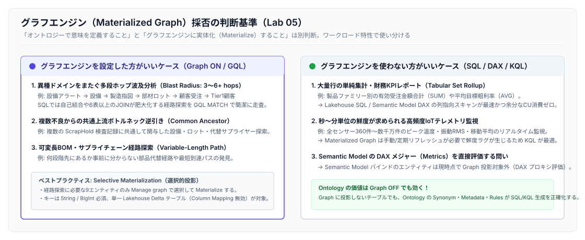

# Lab 05 — グラフエンジン（Materialized Graph）を設定した方がいいシナリオ vs そうでない方がいいシナリオ

> **所要時間**: 約 25 分  
> **ゴール**: Fabric Ontology の裏側にある **Graph in Microsoft Fabric（Materialized Graph / GQL エンジン）** の選択的有効化（`Manage graph`）を体験し、**① グラフエンジンが圧倒的に強いシナリオ（多段ホップ波及分析・共通原因探索）** と **② グラフエンジンを使わず SQL / Eventhouse KQL に任せるべきシナリオ（全件集計・高頻度 IoT 時系列分析）** の違いを実機と比較基準で腹落ちさせる。

---

## 5-1. すべてのデータをグラフエンジンに載せてはいけない理由

Fabric Ontology（V2）では、オントロジーを定義したあと **必要な Entity Type と Relationship だけを選択して Graph in Microsoft Fabric（`GraphModel`）へ投影（Materialize）** できます。



| 観点 | Graph Engine **ON** が向くケース | Graph Engine **OFF**（SQL / KQL 直接）が向くケース |
| :--- | :--- | :--- |
| **得意な問い** | **3〜6 ホップ以上**の関係をたどる波及影響範囲（Blast Radius）、サプライチェーン上流・下流トレース、複数不良の**共通原因（Common Ancestor）**探索 | 全レコードの `SUM / AVG / COUNT` ロールアップ、月次・製品群別売上集計、数百万〜数十億行のセンサー時系列ウィンドウ集計 |
| **計算コスト** | ノード・エッジ投影のための Spark リフレッシュ CU とストレージを消費する代わりに、多段経路探索がシンプル・高速 | 列指向圧縮（Delta Parquet）や時系列インデックス（Eventhouse KQL）をそのままスキャンするため、投影オーバーヘッド **ゼロ** で超高速 |
| **本ラボでの適用** | 設備異常 → 設備 → 製造指図 → 顧客受注 → 顧客、および部材ロット → サプライヤーの **コア 11 エンティティのみ ON** | 生センサー波形 `iot_telemetry`（360行〜本番数十億行）や補助明細 `PurchaseOrder` / `Sensor` は **Graph OFF** |

---

## 5-2. Step 1: 選択的グラフ投影（Selective Graph Materialization）を設定・リフレッシュする

Fabric ポータルの `mfg_enterprise_ontology` 画面上部リボンにある **`Manage graph`** を開き、グラフエンジンへ投影するエンティティを選択します。

### ポータル手順（約 2 分）

1. `mfg_enterprise_ontology` の上部リボンから **`Manage graph`** をクリックします。
2. 波及トレースに必要な以下の **11 個の Entity Type にチェックを入れ**、逆に **`erp#PurchaseOrder`** と **`iot#Sensor`** はチェックを外します（また `iot_telemetry` はそもそも独立 Entity にせず時系列テーブルのまま維持しています）：
   - ON にする 11 個: `erp#Customer`, `erp#Supplier`, `erp#Material`, `erp#Product`, `erp#Order`, `mes#ProductionLine`, `mes#Equipment`, `mes#MaterialLot`, `mes#Order`, `mes#QualityInspection`, `iot#EquipmentAlert`
3. **`Save` / `Refresh graph`** をクリックし、グラフの投影リフレッシュを開始します（小規模データのため通常 1〜3 分で完了します）。

CLI から子アイテム `GraphModel` の生成状態を確認してみましょう。

> 🗣️ **プロンプト**
> ```text
> 私のワークスペース内のアイテム一覧を確認し、mfg_enterprise_ontology に紐づく GraphModel アイテムが作成されているか、および ontology-cli の ask_ontology が正常に応答できる状態か確認してください。
> ```

🤖 **Copilot の動き**

- `GET /v1/workspaces/{ws}/items` で `type == "GraphModel"` のアイテムを確認し、Ontology MCP エンドポイントの疎通をチェックします。

---

## 5-3. Step 2: 【Graph Engine ON が輝くシナリオ】5-Hop 波及影響トレースと共通原因探索

まずは、リレーショナル SQL だと何重もの中間テーブル JOIN や複雑なサブクエリが必要になる **「多段ホップのグラフ探索」** を 2 問実行します（`ontology/evaluation_questions.json` の `GRAPH-ON-01`, `GRAPH-ON-02`）。

> 🗣️ **プロンプト**
> ```text
> ontology/evaluation_questions.json の GRAPH-ON-01 と GRAPH-ON-02 の2つの多段ホップ質問を mfg_enterprise_ontology の ask_ontology に投げて結果を表示してください。あわせて、もし同じ5ホップ探索を GQL（ISO Graph Query Language）で書く場合と SQL で書く場合でクエリ構造がどう違うかも簡潔に比較してください。
> ```

🤖 **Copilot の動き**

- `GRAPH-ON-01`（`EQ-VBF-204` の重大アラート起点の 5-Hop 波及トレース）と `GRAPH-ON-02`（品質保留 3 ワークに共通する上流ボトルネック探索）を `ask_ontology` で実行します。
- GQL パターンマッチングと多段 SQL JOIN の構造差を解説します。

✅ **期待する結果**

1. **`GRAPH-ON-01`（下流顧客への 5-Hop 波及影響範囲 / Blast Radius）**:
   - 経路: `ALT-2026-901/902/903` (`iot#EquipmentAlert`) → `EQ-VBF-204` (`mes#Equipment`) ← `WO-2026-1007 / 1012 / 1019` (`mes#Order`) → `SO-2026-004 / 009 / 015` (`erp#Order`) → `CUS-001 / 002 / 003` (`erp#Customer`)
   - 影響受注総額: `4,800万円 + 3,250万円 + 1,920万円（隠れリスク SO-2026-015）` = **99,700,000 円（9,970万円）**
   - 1日あたり SLA ペナルティ合計: `80万円 + 65万円 + 90万円` = **2,350,000 円/日**
2. **`GRAPH-ON-02`（複数不良から上流への共通原因・ダイヤモンド経路探索）**:
   - 3 つの保留ワーク（`WO-2026-1007`, `1012`, `1019`）に共通する上流ノードとして、**設備側の `EQ-VBF-204`** と **部材側の `LOT-MAG-088`（サプライヤー `SUP-003` 東海レアアース精工、水分 182ppm）** の **複合要因（2つの共通祖先）** が一発で浮かび上がり、さらに `MAT-MAG-04` の `backupSupplier` エッジから **代替認定サプライヤー `SUP-007`（信州マグネットマテリアルズ）** まで一直線に特定できます！

### （参考）GQL なら 5 ホップ経路がそのまま直感的に書ける

Graph in Microsoft Fabric が採用している ISO 標準 **GQL** では、この経路が矢印のまま表現されます：

```gql
MATCH (a:EquipmentAlert)-[:triggeredOnEquipment]->(eq:Equipment {equipment_id: 'EQ-VBF-204'})
      <-[:processedByEquipment]-(wo:Order)-[:fulfillsSalesOrder]->(so:Order)
      -[:placedByCustomer]->(c:Customer)
RETURN eq.equipment_id, wo.order_id, so.order_id, so.order_amount_jpy, c.customer_name, c.sla_penalty_jpy_per_day
```

---

## 5-4. Step 3: 【Graph Engine OFF にすべきシナリオ】全件売上ロールアップと高頻度 IoT 時系列集計

次に、**「グラフエンジンを使わない方が圧倒的に速く・安く・正確な 2 つのシナリオ」**（`GRAPH-OFF-01`, `GRAPH-OFF-02`）を検証します。

ここで注目してほしい **Ontology V2 MCP の隠れた超強力機能** があります。`iot_telemetry` のような高頻度テーブルを Graph 投影から外していても、**`ask_ontology` に「オントロジーの定義・コード値・閾値ルールを踏まえた実行可能な SQL / KQL クエリを生成して」と頼む（Grounded Code Generation）** ことで、オントロジーの業務知識を活かしつつ実行は高速な SQL / Eventhouse エンジンに任せることができます！

> 🗣️ **プロンプト**
> ```text
> 今度はグラフエンジンを使わない方がよい2つのシナリオ（ontology/evaluation_questions.json の GRAPH-OFF-01 と GRAPH-OFF-02）を検証します。
> 1) ask_ontology を使って、オントロジーのステータス定義（order_status_code != 0）や異常閾値メタデータを踏まえた「製品ファミリー別受注金額集計 SQL」と「設備別テレメトリ異常集計クエリ（SQL または Eventhouse KQL）」を生成させてください。
> 2) 生成されたクエリを mfg_ontology_lh（および作成済みの場合は mfg_telemetry_eh）で直接実行し、data/expected_oracle.json の集計値と一致するか確認してください。
> 3) なぜこの2つは Materialized Graph に載せず SQL / KQL で実行すべきなのか、実測とアーキテクチャの両面から整理してください。
> ```

🤖 **Copilot の動き**

- `ontology-cli` の Grounded Code Generation パターン（`Generate runnable SQL/KQL code only...`）で `ask_ontology` から正確なクエリを生成させます。
- Lakehouse SQL Analytics Endpoint（または Spark SQL / Eventhouse KQL）で実行し、結果が `expected_oracle.json` と完全一致することを検証します。

✅ **期待する結果**

- **`GRAPH-OFF-01`（製品ファミリー別の有効受注金額集計 — `SO-2026-011` の取消分 `status=0` を除外）**:
  - `ServoActuator`: **150,400,000 円**
  - `LinearModule`: **99,600,000 円**
  - `CleanroomActuator`: **58,500,000 円**
  - `DirectDrive`: **50,400,000 円**
- **`GRAPH-OFF-02`（`iot_telemetry` 360件の時系列ピーク・異常件数集計）**:
  - `EQ-VBF-204`: 最高温度 **`859.4 ℃`**、最低真空悪化ピーク **`9.5 Pa`**、異常フラグ行数 **`4 件`**
  - `EQ-CNC-101`: 最大振動 **`5.12 mm/s`**、異常フラグ行数 **`2 件`**

---

## 5-5. 実務で迷わない！「グラフエンジン ON / OFF」5 つの意思決定チェックリスト

今後、自社のオントロジー案件で「どこまで Graph に載せるか？」を判断するときは、以下の 5 項目でチェックしてください。

1. **ホップ数（Hop Depth）**: 3 ホップ以上の多段トレース・階層展開・経路探索があるか？ → **YES なら Graph ON**（1テーブル集計や単純な Fact-Dimension 1回 JOIN だけなら SQL / Semantic Model で十分）。
2. **カーディナリティ（行数規模）**: 数千万〜数十億行の明細ログや生テレメトリか？ → **生ログは Graph OFF（Eventhouse KQL / Lakehouse SQL）** に置き、異常イベント（`EquipmentAlert`）や設備マスタ（`Equipment`）だけを Graph ノードにする。
3. **更新頻度と鮮度要件**: 秒〜分単位のリアルタイムストリーミングか？ → **ストリーミング波形は Eventhouse KQL** に任せ、Graph Materialization はマスタ・状態遷移・アラート関係に絞る。
4. **クエリの主目的**: 「誰・どのロット・どの設備と繋がっているか（Topology）」を知りたいなら **Graph ON**、「期間全体の平均・合計・分散（Aggregation）」を知りたいなら **Graph OFF**。
5. **ハイブリッド活用**: Graph OFF にしたテーブルでも、オントロジー側の **Metadata / Business Rules を参照して SQL / KQL を生成させる** ことで、ガバナンスと性能を両立できる。

---

## ✅ チェックポイント

- [ ] `Manage graph` で必要なエンティティだけを選択的にグラフ投影する設計意図を確認した
- [ ] Graph Engine ON が得意な 5-Hop 波及トレース（総額 9,970万円・SLA 235万円/日）と複合共通原因（`EQ-VBF-204` + `LOT-MAG-088`）を確認した
- [ ] Graph Engine OFF（SQL / KQL）に任せるべきロールアップ集計・時系列集計を実行し、使い分け基準を整理できた

次は、完成したオントロジーを **Fabric Data Agent** に接続し、ビジネスユーザーが自然言語で質問したときに Data Agent がどうオントロジーのコンテキストと GQL を活用するかを確認する **[Lab 06 — Fabric Data Agent からの Ontology 呼び出しとコンテキスト検証](./06-data-agent-ontology-context.md)** へ進みます！
